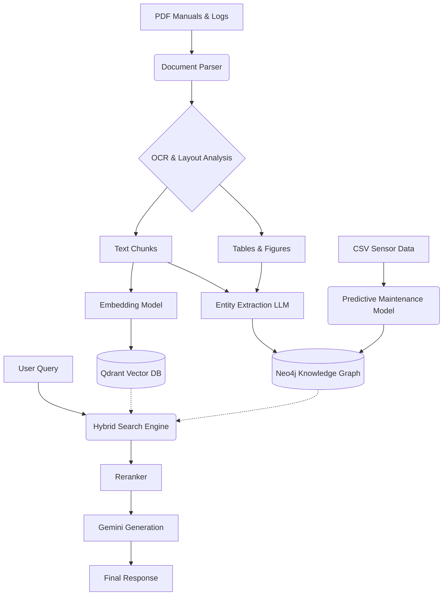

# System Architecture

## Overview
This document details the architecture of the ABB Multimodal Maintenance Intelligence Agent. The system processes complex multimodal industrial documents and sensor data, converting them into a structured knowledge graph that powers an advanced RAG (Retrieval-Augmented Generation) assistant.

## Data Flow Pipeline

## Component Details

1. **Document Parser**: Handles chunking and conversion of PDFs into images.
2. **ML Pipeline (Vision & OCR)**: YOLOv8 for detecting layouts; TrOCR for digitizing text and complex formulas.
3. **Knowledge Extraction**: Extracts components, sub-components, failure modes, and connects them.
4. **Vector Database (Qdrant)**: Stores dense embeddings of text chunks for semantic retrieval.
5. **Graph Database (Neo4j)**: Stores deterministic relationships and hierarchical data (e.g. Pump -> contains -> Bearing).
6. **Backend (FastAPI)**: Orchestrates the pipeline and serves API endpoints.
7. **Frontend (React)**: Chat interface for engineers to query the system and upload files.
